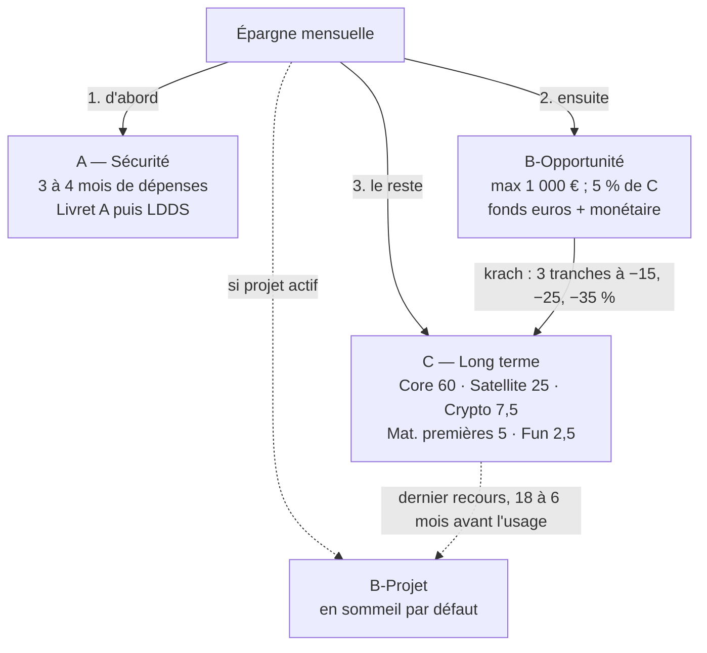

# Guide de gestion du Portefeuille Global

Nov 5, 2026 · @Noé

Ce guide est la règle de gestion définitive du Portefeuille Global. Il ne dépend pas de la valeur actuelle du patrimoine : les mêmes règles s'appliquent à 20 000 € comme à 500 000 €. Chaque règle est formulée pour pouvoir être reproduite telle quelle dans un tableur ou une application.

## 1. Principes

1. **Chaque euro a une seule fonction** : A protège le mode de vie, B finance les opportunités et les projets, C capitalise sur le long terme.
2. **Tous les pourcentages sont exprimés en % de la poche concernée**, jamais du patrimoine total.
3. **Ne jamais prendre de risque élevé avec de l'argent dont la date d'usage est proche.**
4. **On agit uniquement quand une règle écrite se déclenche.** Une hausse, une baisse ou une actualité ne suffisent pas.
5. **On corrige d'abord avec les nouveaux versements**, on vend en dernier recours.

## 2. Paramètres

Ces valeurs sont les seuls chiffres du guide. Dans un tableur ou une application, elles forment une table de paramètres modifiable sans toucher aux formules.

| Code | Paramètre | Valeur |
| --- | --- | --- |
| `A_MOIS` | Mois de dépenses essentielles couverts par A | 3 si revenu stable ; 4 si revenu variable, risque de change ou contrat précaire |
| `BO_MIN` | Montant minimum de B-Opportunité | 1 000 € |
| `BO_CIBLE` | Cible de B-Opportunité | 5 % de C |
| `BO_PLAFOND` | Plafond de B-Opportunité | 10 % de C |
| `BO_SEUIL_MONE` | Montant de B-Opportunité à partir duquel une part passe en monétaire | 5 000 € |
| `BO_PART_MONE` | Part placée en fonds monétaire hors assurance-vie au-delà du seuil | 1/3 |
| `K_PALIERS` | Paliers de baisse du MSCI World en euros, depuis son plus haut | −15 %, −25 %, −35 % |
| `K_TRANCHE` | Part de B-Opportunité déployée à chaque palier | 1/3 |
| `K_FIN` | Niveau de fin d'épisode de krach | Baisse revenue au-dessus de −10 % |
| `BP_MARGE` | Marge de sécurité de B-Projet | 10 % |
| `SAT_SCORE_MIN` | Score minimal du guide de sélection pour acheter | 75/100 |
| `SAT_ENTREE` | Taille d'entrée d'une action | 2 % de C |
| `SAT_NORMALE` | Taille normale d'une action | 2 à 3,5 % de C |
| `SAT_MAX` | Taille maximale d'une action en direct | 5 % de C |
| `SAT_EXPO_REVUE` | Exposition directe + via ETF déclenchant une revue | 7,5 % de C |
| `SAT_FENETRE` | Fenêtre de mesure du Satellite | 3 ans glissants |
| `SAT_ECART` | Sous-performance déclenchant la réduction | 2 points par an |
| `SAT_PLANCHER` | Cible réduite du Satellite | 15 % de C |
| `SAT_PLAFOND` | Plafond absolu du Satellite | 30 % de C |
| `WATCHLIST_MAX` | Nombre maximal d'entreprises en watchlist | 15 |
| `FRAIS_CIBLE` | Frais annuels totaux | Moins de 0,5 % ; alerte au-delà de 1 % |
| `EPARGNE_TAUX` | Taux d'épargne mensuel cible | À fixer |

## 3. Les poches et leurs règles

### A — Sécurité

- **Cible** : `cible_A = dépenses essentielles mensuelles × A_MOIS`.
- **Supports** : Livret A, puis LDDS au-delà du plafond du Livret A.
- **Usage** : urgence, baisse de revenu, dépense imprévue indispensable. Jamais investi, jamais utilisé pour un krach ou un projet.
- **Reconstitution** : après un retrait, 100 % de l'épargne va à A jusqu'à sa cible.

### B-Opportunité — la réserve de krach

- **Cible** : `cible_BO = max(BO_MIN ; BO_CIBLE × C)`.
- **Plafond** : `plafond_BO = max(BO_MIN ; BO_PLAFOND × C)`. Au-dessus, le surplus rejoint C lors de la revue annuelle.
- **Supports** : fonds euros dans une assurance-vie qui contient aussi des unités de compte de C, pour basculer vers C par simple arbitrage. Au-delà de `BO_SEUIL_MONE`, `BO_PART_MONE` passe sur un fonds monétaire euro hors assurance-vie, pour limiter le risque de blocage temporaire des retraits prévu par la loi Sapin 2.
- **Usage** : uniquement la règle de krach (section 5).

### B-Projet — en sommeil par défaut

Pour un projet immobilier, entrepreneurial ou autre, dès qu'il devient concret et daté. Tant qu'aucun projet n'est concret, B-Projet vaut 0 €.

- **Montant** : `montant_BP = (coût à financer + frais) × (1 + BP_MARGE)`.
- **Effort mensuel** : `effort_BP = max(0 ; montant_BP − BP) / mois restants`, prélevé sur l'épargne avant C.
- **Jamais utilisé en krach.**
- **Supports selon le temps restant** :

| Temps avant l'usage | Supports |
| --- | --- |
| Plus de 3 ans | Fonds euros majoritaire + livrets |
| 1 à 3 ans | Livrets + fonds euros |
| Moins de 12 mois | Livrets ou fonds monétaire, 100 % disponible |

- **Si l'épargne ne suffit pas** : transférer de C vers B-Projet en dernier recours, par tiers, entre 18 et 6 mois avant l'usage.

### C — Long terme

| Sous-poche | Cible | Bande | Contenu |
| --- | --- | --- | --- |
| Core ETF | 60 % | 55–65 % | MSCI World 37,5 %, marchés émergents 15 %, Europe 7,5 % (pas de S&P 500) |
| Satellite actions | 25 % | 15–30 % | Entreprises sélectionnées avec le guide de sélection |
| Crypto | 7,5 % | 5–10 % (plafond dur) | BTC, éventuellement ETH |
| Matières premières | 5 % | 3–8 % | Or 3 %, panier diversifié 2 % |
| Fun / alternatifs | 2,5 % | 0–5 % | Spéculatif, y compris la crypto spéculative ; peut perdre 100 % |

## 4. Algorithme des flux mensuels

Chaque mois, l'épargne `E` est répartie dans l'ordre ci-dessous ; chaque étape ne reçoit que ce qui reste après la précédente (`reste`).

1. **A** : `vers_A = min(E ; max(0 ; cible_A − A))`.
2. **B-Projet**, s'il est actif : `vers_BP = min(reste ; effort_BP)`.
3. **B-Opportunité**, hors épisode de krach : `vers_BO = min(reste ; max(0 ; cible_BO − BO))`. Pendant un épisode de krach (section 5), cette étape est suspendue.
4. **C** : le reste va aux sous-poches sous leur cible, au prorata de leur manque :
   - `manque_i = max(0 ; cible_i × (C + reste) − valeur_i)` ;
   - `vers_i = reste × manque_i / somme des manques`.

La même règle répartit l'argent du Core entre World, émergents et Europe. La part du Satellite va à l'action à renforcer décidée lors de la dernière revue ; s'il n'y en a pas, elle est placée provisoirement sur l'ETF MSCI World et comptée dans le Satellite jusqu'à l'achat.

Le virement est programmé le jour de la paie, avant toute dépense.

## 5. Règle de krach : B-Opportunité vers C

Une baisse seule ne suffit jamais : la règle fixe à l'avance combien déployer et à quelles conditions.

- **Indicateur** : `baisse = MSCI World en euros / son plus haut historique − 1`, idéalement dividendes réinvestis.
- **Début d'épisode** : la première fois que la baisse atteint −15 %. On fige alors `BO_départ` = valeur de B-Opportunité, et `tranche = BO_départ × K_TRANCHE`.

| Palier atteint | Tranche déployée | Cumul déployé |
| --- | --- | --- |
| −15 % | 1re tranche | 1/3 de `BO_départ` |
| −25 % | 2e tranche | 2/3 de `BO_départ` |
| −35 % | 3e tranche | 100 % de `BO_départ` |

- Chaque tranche ne se déclenche qu'une fois par épisode.
- **Conditions avant chaque tranche** : A à sa cible ; la destination reste sous son plafond ; la décision est notée au journal.
- **Destination** : les sous-poches du Core sous leur cible (même formule que les flux). Une action Satellite seulement si sa fiche est à jour, son score au moins égal à `SAT_SCORE_MIN` et sa taille sous `SAT_MAX`.
- **Fin d'épisode** : quand la baisse remonte au-dessus de `K_FIN` (−10 %). Les tranches sont réinitialisées et B-Opportunité se reconstitue par l'étape 3 des flux.
- A et B-Projet ne sont jamais utilisés en krach.

## 6. Rééquilibrage

- **Contrôle** : chaque trimestre, comparer le poids de chaque sous-poche de C à sa bande.
- **Première correction** : les flux mensuels corrigent automatiquement les écarts (section 4).
- **Correction par vente** : si une sous-poche est encore hors bande à la revue annuelle, vendre ou acheter pour la ramener à sa cible, de préférence à l'intérieur d'une même enveloppe pour éviter l'impôt.
- **Crypto au-dessus de 10 %** : plafond dur, retour à 7,5 % dans le trimestre, sans attendre la revue annuelle.
- **B-Opportunité au-dessus de son plafond** : le surplus rejoint C à la revue annuelle.
- **Chaque année** : recalculer `cible_A` à partir des dépenses essentielles réelles.

## 7. Satellite : cycle de vie d'une action et mesure

### Cycle de vie

| Étape | Règle |
| --- | --- |
| Watchlist | `WATCHLIST_MAX` entreprises au plus, chacune avec sa fiche (guide de sélection) |
| Acheter | Score au moins égal à `SAT_SCORE_MIN` ; thèse, anti-thèse et conditions de sortie écrites ; taille `SAT_ENTREE` |
| Renforcer | Thèse intacte, résultats conformes, valorisation plus attractive ; taille dans `SAT_NORMALE`, jamais au-delà de `SAT_MAX` |
| Conserver | Thèse intacte et valorisation raisonnable ; ne pas vendre parce que l'action a monté |
| Réduire | Au-dessus de `SAT_MAX` : retour dans `SAT_NORMALE` ; valorisation extrême ; exposition directe + via ETF au-delà de `SAT_EXPO_REVUE` : revue obligatoire |
| Vendre | Thèse cassée, détérioration fondamentale durable ou condition de sortie atteinte |

Pas de stop-loss mécanique. Question de contrôle à chaque revue : « Si je ne possédais pas cette action, l'achèterais-je au prix actuel ? »

### Mesure par le portefeuille fantôme

- À chaque achat ou vente d'une action Satellite, enregistrer la même opération, même montant et même date, sur un ETF MSCI World fictif.
- Chaque année, calculer le taux de rendement interne (fonction XIRR, ou TRI.PAIEMENTS dans un tableur en français) du Satellite et du portefeuille fantôme sur `SAT_FENETRE`.
- `écart = TRI_Satellite − TRI_fantôme`.
- Si `écart < −SAT_ECART` : la cible du Satellite passe à `SAT_PLANCHER` (15 %) et la différence rejoint le Core.
- Si, après une réduction, l'écart redevient positif ou nul sur une nouvelle fenêtre de 3 ans : retour à la cible de 25 %.
- Le Satellite ne dépasse jamais `SAT_PLAFOND`. Aucune décision avant 3 ans d'historique.

## 8. Routine de gestion

| Fréquence | Durée | Actions |
| --- | --- | --- |
| Mensuel | Automatique, 5 min de contrôle | Virement le jour de paie selon l'algorithme des flux ; aucune lecture des cours |
| Trimestriel | 30 à 45 min | Mettre à jour le tableau de bord ; relire les fiches des actions qui ont publié leurs résultats ; vérifier les bandes et les paliers de krach |
| Annuel | 2 h | Recalculer `cible_A` ; rééquilibrer C ; mesurer le Satellite face au portefeuille fantôme ; ramener B-Opportunité sous son plafond ; revue des frais et de la fiscalité |
| Événement | Selon besoin | Palier de krach atteint, changement d'emploi ou de résidence, projet devenu concret : appliquer la règle écrite correspondante |

Entre deux revues, la seule raison d'agir est une règle écrite qui se déclenche.

## 9. Tableau de bord et alertes

Chaque indicateur a une formule, une cible et un seuil d'alerte : c'est la liste des calculs qu'un tableur ou une application doit afficher.

| Indicateur | Formule | Cible | Alerte |
| --- | --- | --- | --- |
| Taux d'épargne | épargne du mois / revenu net | `EPARGNE_TAUX` | Sous la cible 3 mois de suite |
| Couverture de A | A / dépenses essentielles mensuelles | `A_MOIS` | Moins de 3 mois |
| B-Opportunité | BO / `cible_BO` | 100 % | Sous la cible hors krach, ou au-dessus de `plafond_BO` |
| Poids de chaque sous-poche de C | valeur de la sous-poche / C | Sa cible | Hors de sa bande |
| Crypto | valeur crypto / C | 7,5 % | Au-delà de 10 % : action immédiate |
| Plus grosse position | (détention directe + part via ETF) / C | `SAT_MAX` au plus | Au-delà de `SAT_EXPO_REVUE` |
| Baisse du MSCI World | cours / plus haut historique − 1 | — | Palier de `K_PALIERS` atteint |
| Écart du Satellite | TRI\_Satellite − TRI\_fantôme, sur 3 ans | 0 ou plus | Moins de −2 points par an |
| Frais annuels | frais payés / patrimoine moyen | Moins de 0,5 % | Plus de 1 % |
| B-Projet (si actif) | BP / montant prévu par le plan à date | 100 % | Retard de plus de 3 mois d'effort |

## 10. Modèle de données pour un tableur ou une application

Onze tables suffisent ; dans un tableur, chacune devient un onglet, dans une application une table de base de données.

| Table | Une ligne = | Champs principaux |
| --- | --- | --- |
| Paramètres | Un paramètre de la section 2 | Code, valeur, unité, date de modification |
| Comptes | Une enveloppe | Nom, type (Livret, PEA, assurance-vie, compte-titres, crypto), établissement |
| Actifs | Un actif détenu ou suivi | Nom, ISIN ou ticker, poche (A, B-Opportunité, B-Projet, C), sous-poche (World, émergents, Europe, Satellite, crypto, or, panier, Fun, fonds euros, monétaire, livret), compte, frais courants |
| Opérations | Un mouvement | Date, actif, type (versement, achat, vente, arbitrage, retrait, dividende, frais), quantité, prix, montant, frais, règle déclenchée |
| Valorisations | Un relevé de valeur | Date, actif, quantité, cours, valeur |
| Flux mensuels | Un mois | Mois, revenu net, dépenses essentielles, épargne, vers A, vers B-Projet, vers B-Opportunité, vers chaque sous-poche de C |
| Indice | Un relevé du MSCI World en euros | Date, valeur, plus haut historique, baisse, épisode de krach actif, tranches déclenchées, `BO_départ` |
| Fiches Satellite | Une entreprise | Actif, score sur 100, thèse, anti-thèse, conditions de sortie, statut (watchlist, détenue, vendue), date de dernière revue |
| Portefeuille fantôme | Une opération miroir | Date, montant, cours de l'ETF World, parts achetées ou vendues |
| Journal de décision | Une décision | Date, actif, action, montant, poids avant et après, motif, règle déclenchée, prochaine revue |
| B-Projet | Un projet | Nom, coût à financer, frais, date d'usage, `montant_BP`, statut (en sommeil, actif, réalisé) |

### Calculs à automatiser

1. Valeur de chaque poche et sous-poche à partir des valorisations.
2. Cibles : `cible_A`, `cible_BO`, `plafond_BO`, `montant_BP`, `effort_BP`.
3. Répartition de l'épargne du mois selon l'algorithme de la section 4.
4. Écarts aux cibles et aux bandes de C.
5. Baisse du MSCI World, état de l'épisode de krach et montant de la prochaine tranche.
6. TRI du Satellite et du portefeuille fantôme sur 3 ans glissants.
7. Alertes du tableau de bord.

*Ce guide est un cadre d'organisation personnel, pas une promesse de rendement ni un conseil en investissement personnalisé. Une perte importante reste possible, en particulier dans C.*
